# Nanjing Housing Price Estimator

Machine-learning analysis of **20,432 second-hand home listings in Nanjing**. The project segments the market with K-Means clustering and predicts total price with three tree-based regression models. It also includes an interactive web app built with Gradio.

| Model | R² | Typical error (MAE) | RMSE |
|---|---|---|---|
| Decision Tree (baseline) | 0.874 | ¥0.31M | ¥0.64M |
| Random Forest | 0.896 | ¥0.28M | ¥0.59M |
| **Gradient Boosting** | **0.909** | **¥0.27M** | **¥0.55M** |

*Scores are on a held-out test set of 4,079 listings that the models never saw during training.*

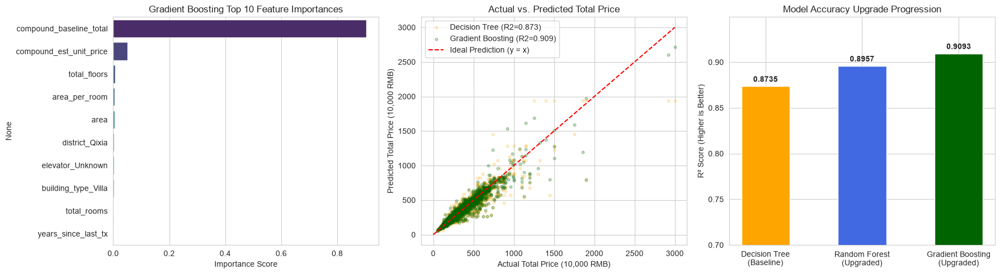

---

## Project structure

```
classproject/
├── classproject.ipynb          # Full analysis: cleaning → EDA → clustering → models → walkthrough
├── app.py                      # Gradio web app (price estimate, market data, model accuracy)
├── ershoufang-origin-utf8.csv  # Dataset: Nanjing second-hand housing listings (Chinese column names)
├── requirements.txt            # Pinned Python dependencies
├── images/                     # README images: notebook charts and app screenshots
└── .gitignore
```

Generated files (not committed):

- `model_artifacts.joblib`: trained models and data for the app. Created by the last cell of the notebook.
- `classproject.html`: optional HTML export of the notebook.

---

## Getting started

Requires **Python 3.12**.

```bash
# 1. Create a virtual environment and install dependencies
python -m venv myenv
myenv\Scripts\python -m pip install -r requirements.txt        # Windows
# myenv/bin/python -m pip install -r requirements.txt          # macOS / Linux

# 2. Run the notebook (trains the models and saves model_artifacts.joblib)
myenv\Scripts\python -m jupyter nbconvert --to notebook --execute --inplace classproject.ipynb

# 3. Start the web app; it opens at http://127.0.0.1:7860
myenv\Scripts\python app.py
```

**Using VS Code:** open `classproject.ipynb`, choose the `myenv` Python interpreter as the kernel, and click **Run All**. The Python and Jupyter extensions must be installed.

---

## What the notebook does

### 1. Data cleaning
- Converts text fields to numbers: `30052元/平米` → 30052, `130.5㎡` → 130.5, `3室2厅1厨2卫` → 3 bedrooms / 2 living rooms / 2 bathrooms, `中楼层 (共16层)` → Mid floor, 16 floors.
- **Fixes 202 villa listings** whose columns are shifted by one position in the raw CSV. Without this fix their decoration, orientation and building type would be wrong.
- Translates categories to English (district, decoration, building type, elevator, and so on).
- Removes 28 rows with missing core values (mostly garages) and 11 extreme outliers, leaving **20,393 listings**.

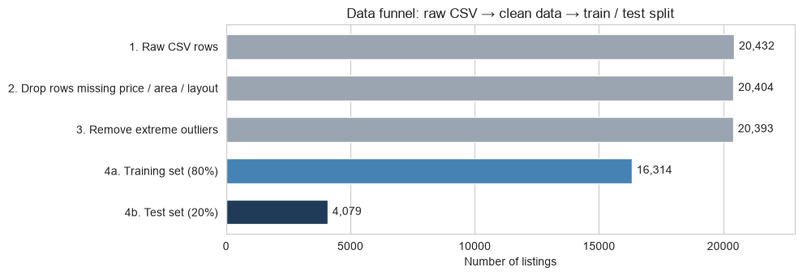

### 2. Exploratory analysis
Listings per district, price per m² by district, and price vs. floor area.

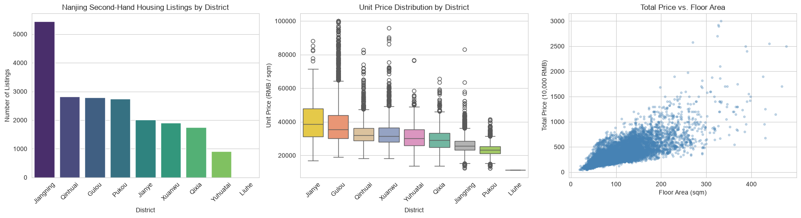

- **Jiangning** has the most listings (about 5,400), more than any other district.
- **Jianye** and **Gulou** are the most expensive per m² (median about 36–39k RMB/m²). **Pukou** is the cheapest (about 23k).
- Total price rises with floor area, but the spread widens a lot for large homes.

### 3. Market segmentation (K-Means)
Standardises total price, unit price and area, chooses **K = 5** with the elbow method, and profiles each segment.

<p align="center">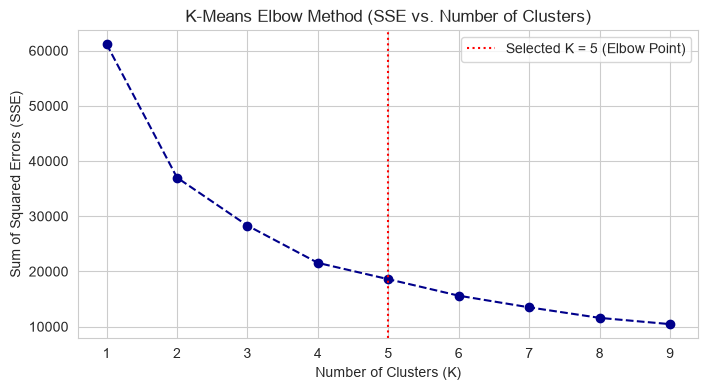</p>

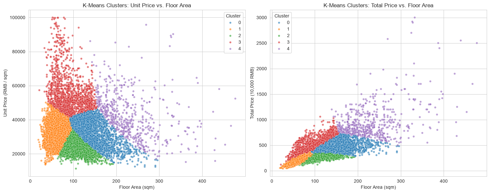

| Cluster | Listings | Avg price | Avg price / m² | Avg area | Segment |
|---|---|---|---|---|---|
| 1 | 8,003 | ¥1.96M | 30,785 | 63 m² | Small affordable flats |
| 2 | 6,537 | ¥2.49M | 24,322 | 103 m² | Mid-size, lower-cost areas |
| 0 | 3,733 | ¥4.44M | 32,313 | 141 m² | Large family homes |
| 3 | 1,530 | ¥4.94M | 55,305 | 91 m² | Prime-location flats |
| 4 | 590 | ¥9.52M | 42,412 | 231 m² | Luxury / villas |

### 4. Price prediction
- **Features:** area, layout, floors, floor level, orientation, years since last sale, plus one-hot encoded district, decoration, building type, elevator, tenure and structure.
- **Compound price encoding:** each residential compound's average price per m², smoothed toward the city mean and computed **only from training data**, so no test information leaks into the features.
- **80/20 train/test split** (`random_state=42`). The three models are compared on R², MAE and RMSE, with feature-importance and actual-vs-predicted charts (see the chart at the top).
- The most important feature by far is `compound_baseline_total` (compound price per m² × floor area). Location is the main driver of price.

**How the models learn.** Dashed lines are error on training houses and solid lines are error on new houses:

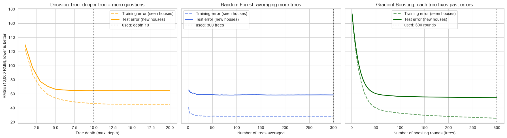

**The first two levels of the Decision Tree:**

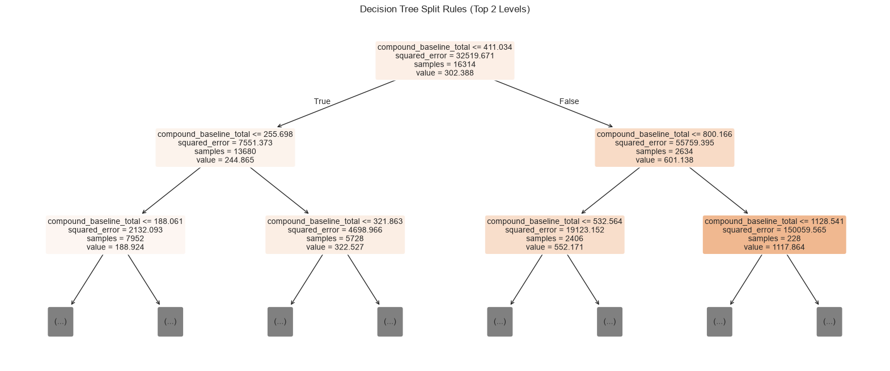

### 5. Walkthrough: from raw data to prediction
Follows a single test-set house through the whole pipeline:
- a data funnel showing the row count after each step
- the house's raw text next to its cleaned features and the model input vector
- learning curves for each model (training vs. test error)
- the house's path through the Decision Tree's yes/no questions
- Gradient Boosting building the prediction tree by tree, and Random Forest's 300 tree "votes"
- `predict_house()` to estimate the price of any home you describe

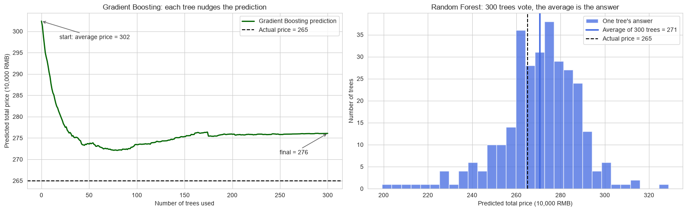

---

## Web app

`app.py` loads the saved models and provides three tabs:

| Tab | What you can do |
|---|---|
| **Price estimate** | Fill in a guided form (location → size & layout → building & condition) and get an estimated price, a likely range and a comparison of all three models. **Load sample listing** picks a real test-set home so you can see the estimate next to the actual price. **Random home** generates a made-up home. |
| **Market data** | Filter by district, area and price. Shows summary statistics, charts and a table of listings. |
| **Model accuracy** | Score cards for each model in plain language ("typical error", "within 10% of actual"), plus actual-vs-predicted and feature-importance charts. |

### Price estimate

A guided three-step form on the left, and the estimate on the right. In this example a real listing was loaded with **Load sample listing**: the model estimated **¥2.87M** against an actual listed price of **¥3.06M** (−6.3%). The black line on each bar marks the actual price.

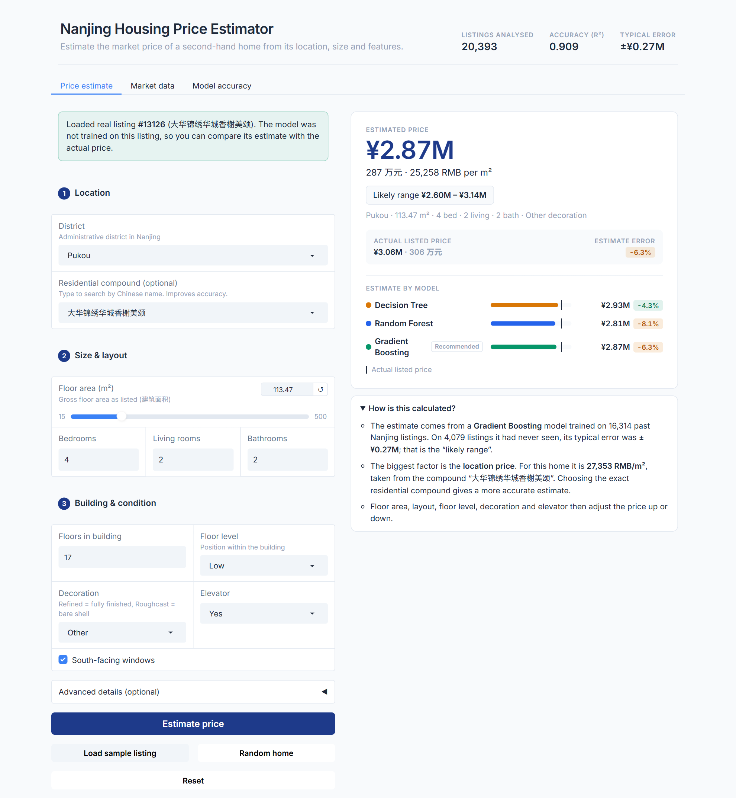

<details>
<summary>Close-up of the result card</summary>

<p align="center">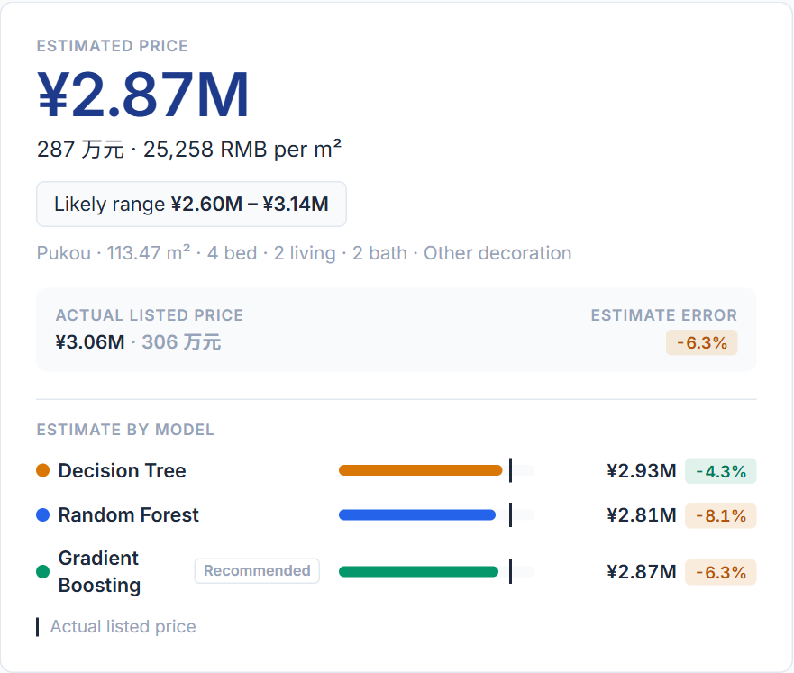</p>

The card shows:
- the estimated price in ¥M and 万元, plus the price per m²
- the likely range (estimate ± the model's typical error)
- for sample listings, the actual price and a colored error badge: green under 5%, amber 5–15%, red over 15%
- each model's estimate as a colored bar

</details>

### Market data

Filter by district, floor area and price. The summary tiles, both charts and the listings table update right away.

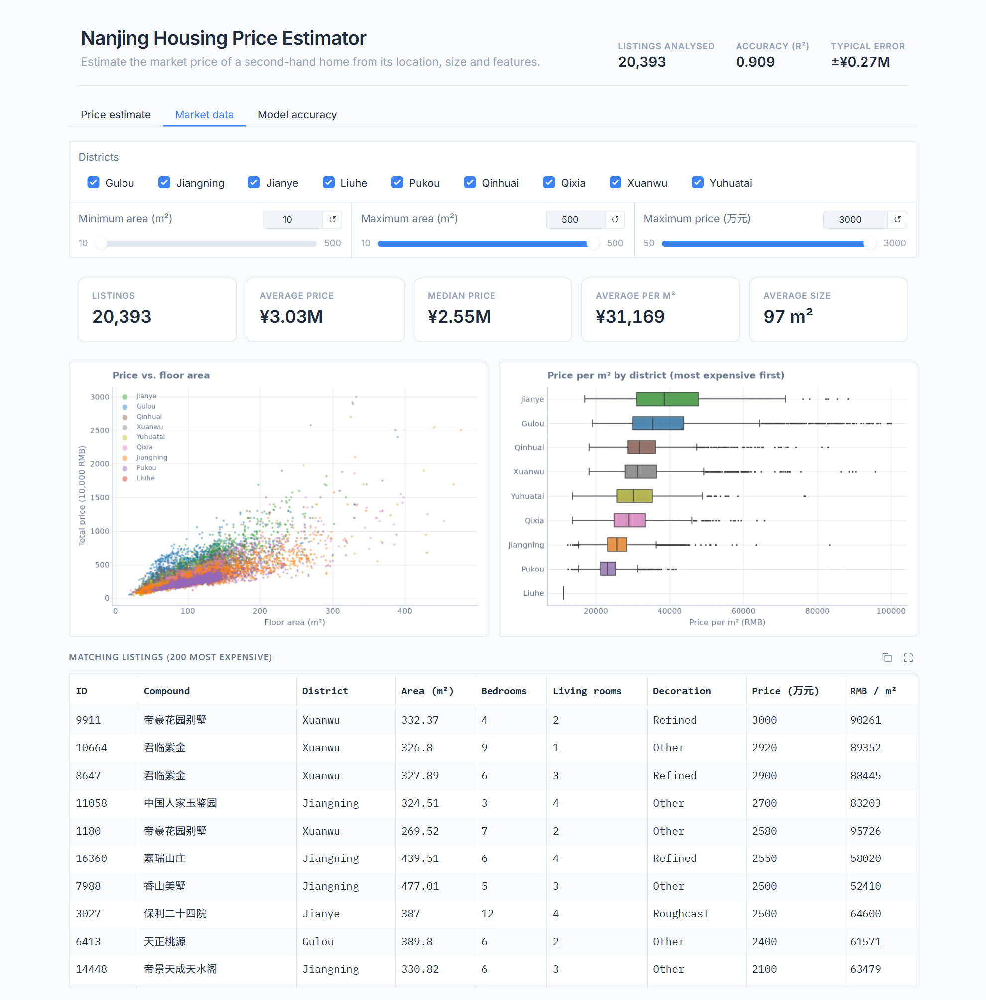

### Model accuracy

Plain-language score cards for each model, plus charts for the model you select.

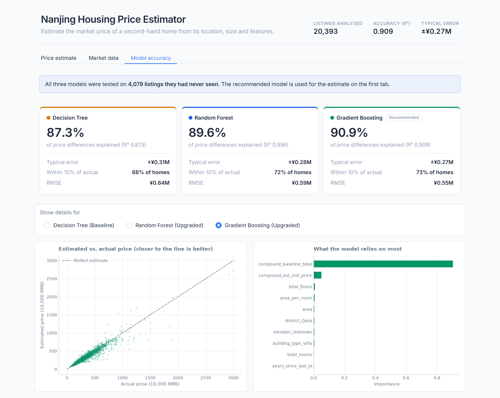

**Design notes**
- Neutral slate and navy interface with the Inter font. It follows the system light/dark setting.
- Each model keeps one color everywhere: amber for Decision Tree, blue for Random Forest, green for Gradient Boosting. The colors were checked for color-blind separation in light and dark mode, and model names are always shown next to them.
- Every input has a short hint, and rarely used fields are grouped under **Advanced details**.

> After changing or retraining the models in the notebook, re-run its last cell to update `model_artifacts.joblib` before starting the app.

---

## Notes and limitations

- Prices are listing prices, not final sale prices. They are in 10,000 RMB (万元) in the data and shown as ¥ millions in the app.
- The biggest single predictor is the residential compound's historical price per m². For compounds not in the training data, the app falls back to the district average, so those estimates are less precise.
- `scikit-learn` is pinned in `requirements.txt` because the saved `model_artifacts.joblib` must be loaded with the same version that created it.
